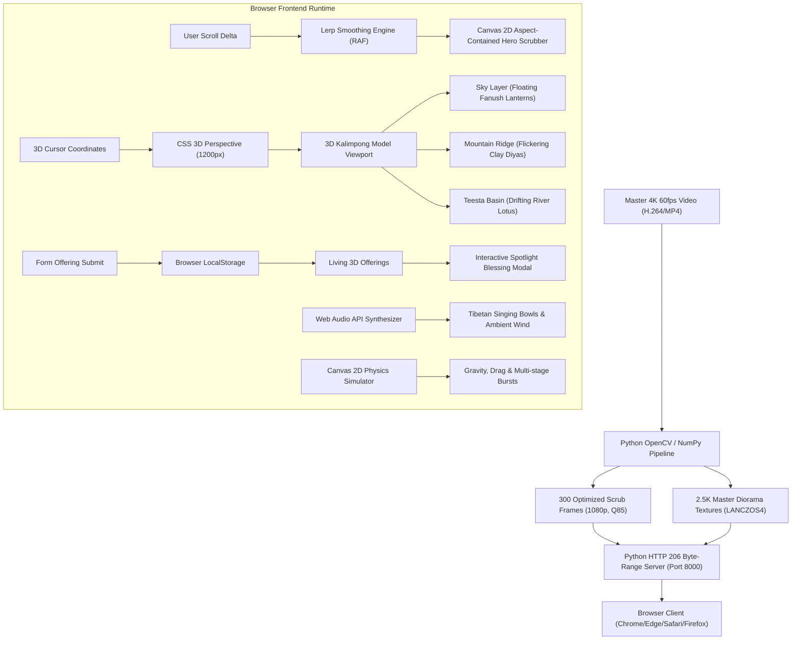

# 🪔 Diwali in Kalimpong • A Himalayan Festival of Lights

> An immersive, high-end web experience crafted around the 4K 60FPS video of **Kalimpong**, featuring an Apple-style **scroll-scrubbed video hero**, spatial holographic UI design, a living **3D Kalimpong Diorama Sanctuary** with interactive offerings, real-time particle physics fireworks, and procedural Web Audio synthesizers.

---

## 🏗️ Architecture Flow



---

## 🛠️ Tech Stack & Purpose

| Layer | Technology | Purpose |
| :--- | :--- | :--- |
| **Frontend Core** | **Semantic HTML5** | Provides accessible DOM structure, `<canvas>` viewports, responsive SVG iconography, and form inputs. |
| **Styling & 3D** | **Modern CSS3** | Powers the Himalayan luxury dark-gold design system, glassmorphism (`backdrop-filter: blur()`), and CSS Grid/Flexbox layouts. |
| **Spatial 3D Engine** | **CSS 3D Transforms & Perspective** | Powers the realistic 3D Kalimpong Diorama (`perspective(1200px)`). Tilts terrain and offerings (`rotateX`/`rotateY`) on separate depth planes (`translateZ`). |
| **Animation Physics** | **CSS Keyframes (`@keyframes`)** | Natural flame flickering (`diyaRidgeGlow`), buoyant wind sway (`lanternSkyFloat`), and water ripple rings (`waterRippleExpand`). |
| **Logic & Controller** | **Vanilla JavaScript (ES6+)** | Zero-bloat, high-performance client logic with zero third-party dependencies (no React or Webpack runtime overhead). |
| **Video Scrub Engine** | **HTML5 Canvas 2D + Lerp** | Renders 300 sequential Full HD frames smoothly at 60 FPS in sync with the user's scroll position, with aspect-ratio containment. |
| **Particle Simulation** | **Canvas 2D Particle Engine** | Simulates fireworks gravity, velocity, drag, sparkle trails, and sky lantern ascension in real time. |
| **Sound Synthesis** | **Web Audio API** | 100% procedural sound synthesis without audio downloads: dual-sine harmonic Tibetan singing bowls (784Hz / 880Hz), pink noise mountain wind, and firework thuds. |
| **Client Persistence** | **Web Storage API (`localStorage`)** | Saves community Diya and Sky Lantern submissions so offerings remain physically active across reloads. |
| **Media Processing** | **Python 3 (`cv2` / OpenCV & `numpy`)** | Extracted 300 uniformly spaced 1080p frames from 4K 60fps video and produced 2.5K LANCZOS4 textures. |
| **HTTP Delivery** | **Python `http.server` (HTTP 206)** | Serves assets with HTTP 206 Partial Content (Byte-Range) support for instant video seek and media streaming. |
| **Version Control** | **Git & GitHub CLI (`gh`)** | Repository hosting and version management. |

---

## 🌟 Key Features

### 1. 🎞️ Apple-Style Scroll-Scrubbed 4K Hero
- **Smooth Scrubbing Engine:** Uses `requestAnimationFrame` with linear interpolation (lerp smoothing at 0.4) to scrub forward and backward through the 300 Full-HD frames as you scroll.
- **Unobstructed View:** Clean video canvas without baked-in artificial UI elements.
- **Sticky Viewport Pinning:** Locks the hero section into place during scrubbing to eliminate jumpy page leaps or empty gaps.

### 2. 🪟 Spatial UI Showcase
- **3D Parallax Tilt:** Mouse-reactive 3D depth effect (`perspective(1000px) rotateX/rotateY`) replicating a holographic console.
- **Interactive Hotspots:** Pulsating waypoints pointing to *Durpin Monastery (Zang Dhok Palri)*, the *Town Portal*, and the *Teesta River Basin*.
- **Glassmorphism Spec Sheet:** Frosted acrylic styling presenting topographical elevation and cultural highlights.

### 3. 🪔 The Living Ridge & Sky Sanctuary (3D Diorama Altar)
- **Realistic 3D Kalimpong Model:** Built on top of the 3D diorama model of Kalimpong, showing the Himalayan night sky, Durpin Monastery, hillside town terraces, and the river valley below.
- **No Artificial Line Dividers:** Natural geographical placement according to the 3D terrain:
  - **Sky Lanterns (🏮):** Float in 3D space (`translateZ(50px)`) above the mountain peaks with wind sway.
  - **Clay Earthen Diyas (🪔):** Rest on mountain ridges and temple ledges (`translateZ(26px)`) with ground-cast golden light halos.
  - **River Lotus Diyas (🪷):** Float in the Teesta River bed (`translateZ(14px)`) with animated expanding water ripples.
- **Click to Reveal Greeting:** Clicking any lamp opens the **Spotlight Blessing Card** showing the contributor's name, mountain calling, dedication blessing, and an interactive **"🔔 Ring Temple Bell"** button.
- **Offering Submission:** Submitting a Diya or Sky Lantern places it physically into the 3D model with a celebratory spawn flare (`.just-lit`) and records it in `localStorage`.

### 4. 🎆 Interactive Himalayan Fireworks & Sky Lanterns Canvas
- **Physics Simulation:** Gravity, drag, multi-stage bursts, smoke trails, and glowing lanterns.
- **Customizable Modes:** Launch **Golden Willow**, **Himalayan Peony**, or float **Sky Lanterns (Fanush)** into the starlit sky.
- **Color Palette Picker:** Imperial Gold, Diya Amber, Monastery Violet, and Mountain Emerald.
- **Grand Finale:** One-click continuous celebratory barrage.

### 5. 🍃 Procedural Himalayan Soundscape (Web Audio API)
- **Zero External Audio Dependencies:** Synthesizes pink noise mountain wind with gusting LFO, gentle valley crickets, Buddhist singing bowls (432Hz / 528Hz harmonics), and firework thuds using native browser Web Audio API.

---

## 🚀 Quick Start

### 1. Run the Local Server
```bash
# Option 1: Python zero-dependency Range Server (Recommended)
python server.py 8000

# Option 2: Using npm
npm start
```

### 2. Open in Browser
Visit **[http://localhost:8000/](http://localhost:8000/)** in your browser.

---

## ⌨️ Keyboard Shortcuts
- `M`: Toggle Himalayan Ambient Soundscape (Wind, Bells, Fireworks)
- `F`: Toggle Fullscreen Mode
- `↑ / ↓`: Smooth Scroll Scrubbing through Video Hero
- `Esc`: Close Blessing Spotlight Modal

---

## 📁 Project Directory Structure
```
diwali/
├── index.html                   # Semantic HTML5 structure & spatial layout
├── styles.css                   # Glassmorphism, 3D transforms & responsive theme
├── app.js                       # Video scrubber, 3D diorama engine, canvas physics & Web Audio
├── server.py                    # Lightweight Python server with HTTP 206 Range support
├── package.json                 # Project configuration & npm scripts
├── README.md                    # Project documentation & architecture diagram
├── .gitignore                   # Ignored files (Python caches, OS files)
├── assets/
│   ├── frames/                  # 300 Full-HD sequential video scrub frames (frame_0000.jpg - frame_0299.jpg)
│   └── images/
│       ├── diorama_overview.jpg # 2.5K Spatial UI diorama card snapshot
│       ├── kalimpong_3d_model_bg.jpg # 2.5K Master 3D Kalimpong model backdrop
│       ├── hero_poster.jpg      # Initial frame poster
│       ├── monastery_glow.jpg   # Durpin monastery fireworks
│       ├── valley_fireworks.jpg # Mountain summit lookout
│       └── sparkle_cascade.jpg  # Golden spark cascade
└── videos/
    └── gemini_replaced_cut_9_to_15_seconds_cleaned_4K_60fps.mp4 # Clean 4K 60fps master footage
```

---

## 📜 License
MIT License • Created for the **Kalimpong Diwali Experience**.
